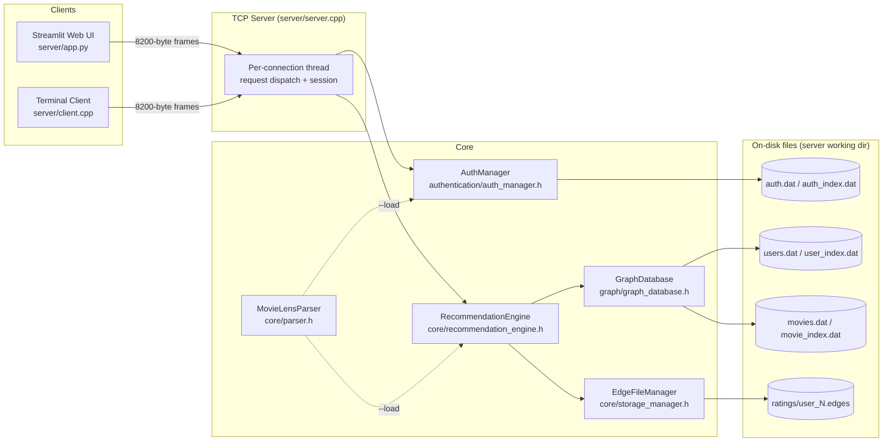

# MovieFlix Suggestion Engine

A movie recommendation system written from scratch in C++17. It has its own disk-backed database (B-tree indexes, fixed-block record storage, per-user edge files), a content-based recommendation algorithm, authentication, and a multi-threaded TCP server. Two clients are included: a terminal client in C++ and a web UI built with Streamlit.

There are no external database or ML libraries. Every index, hash table, storage format, and ranking routine in this repository is implemented by hand.

---

## Table of Contents

1. [Features](#features)
2. [Architecture](#architecture)
3. [Repository Layout](#repository-layout)
4. [Getting Started](#getting-started)
5. [Running the System](#running-the-system)
6. [Configuration Reference](#configuration-reference)
7. [Recommendation Algorithm](#recommendation-algorithm)
8. [Storage Engine](#storage-engine)
9. [Wire Protocol](#wire-protocol)
10. [Concurrency Model](#concurrency-model)
11. [Security Model](#security-model)
12. [Deployment (AWS EC2)](#deployment-aws-ec2)
13. [Known Limitations](#known-limitations)
14. [Dataset & License](#dataset--license)

---

## Features

| Area | What it does |
|---|---|
| **Custom database** | Disk-resident B-tree (minimum degree *t* = 64, up to 127 keys per node) for primary-key indexes. Fixed-size, block-aligned record files for users and movies. One binary edge file per user for ratings. |
| **In-memory indexes** | Hand-written chained hash tables for genre → movie IDs, normalized title → movie ID, username → user ID, and active sessions. Rebuilt from disk at startup. |
| **Recommendations** | Content-based scoring that combines a learned **genre-affinity profile**, **movie quality** (average rating), and a log-scaled **popularity boost**. Top-N selection uses a bounded min-heap. |
| **Cold start** | Users with no ratings get the best-rated title from each of seven major genres. |
| **Trending** | Global ranking by `avgRating × ln(1 + ratingCount)`. |
| **Search** | Case- and punctuation-insensitive substring search on titles, plus browsing by genre. |
| **Authentication** | Registration, login, logout, password change. Credentials are stored in a separate B-tree-indexed file, and identity is bound to the TCP connection on the server. |
| **Bulk loader** | Phased batch loader for MovieLens. It buffers 20,000 ratings at a time and appends them to disk, so memory use stays bounded no matter how big the dataset is. |
| **Server** | Multi-threaded POSIX TCP server (one thread per client) with a simple fixed-frame binary protocol. |
| **Clients** | Interactive terminal client (`client.cpp`) and a Streamlit web UI (`app.py`). |

---

## Architecture



**Layers:**

- **`core/`** contains the primitives: `BTree<K,V>`, `HashTable<K,V>`, `FixedStorage<Node>`, `EdgeFileManager`, `Bitmap`, plus the parser and recommendation engine built on top of them.
- **`graph/`** contains the data model (`User`, `Movie`, `RatingEdge`) and `GraphDatabase`, which combines the B-tree indexes, fixed-block storage, and the in-memory genre and title indexes behind one API. Users and movies are nodes. Ratings are weighted edges from users to movies.
- **`authentication/`** contains `AuthManager`, which handles credentials, user-ID allocation, and session tracking.
- **`server/`** contains the network server and both clients.

---

## Repository Layout

```
suggestion_engine/
├── authentication/
│   └── auth_manager.h          # Registration, login, sessions, password change
├── core/
│   ├── bitmap.h                # Block-allocation bitmap (free-space tracking primitive)
│   ├── btree.h                 # Disk-backed B-tree: insert, search, delete, traversal
│   ├── hash_table.h            # Separate-chaining hash table (uint32 / string keys)
│   ├── parser.h                # MovieLens 100k loader with phased batch flushing
│   ├── recommendation_engine.h # Profiles, scoring, top-N, cold start, popular, search
│   ├── storage_manager.h       # FixedStorage (block-aligned records) + EdgeFileManager
│   └── types.h                 # Global constants: sizes, limits, B-tree degree, batch size
├── graph/
│   ├── graph_database.h        # Facade over indexes, storage, genre/title indexes
│   └── node.h                  # User, Movie, RatingEdge + binary (de)serialization
├── server/
│   ├── server.cpp              # Multi-threaded TCP server and request handlers
│   ├── client.cpp              # Interactive terminal client
│   └── app.py                  # Streamlit web front end ("MovieFlix")
├── report/
│   ├── userguide.pdf           # Project report / user guide
│   └── userguide.odt
├── Makefile                    # Builds server and client
├── requirements.txt            # Python dependencies for the web UI
└── .vscode/                    # Editor settings (Windows/MinGW paths; optional)
```

The `ml-100k/` dataset directory is **not** part of the repository. See [Dataset & License](#dataset--license).

---

## Getting Started

### Prerequisites

| Requirement | Notes |
|---|---|
| Linux or macOS (POSIX sockets) | The server and terminal client use `<sys/socket.h>`. On Windows, use WSL. |
| A C++17 compiler | GCC ≥ 9 or Clang ≥ 10. The code uses `<filesystem>` and `<shared_mutex>`. |
| `make` | Optional. You can also run the `g++` commands below directly. |
| Python ≥ 3.9 and `pip` | Only needed for the web UI. |
| MovieLens 100K dataset | Download link in the next section. |

### 1. Clone

```bash
git clone https://github.com/ibmbt/suggestion_engine.git
cd suggestion_engine
```

### 2. Get the dataset

```bash
curl -LO https://files.grouplens.org/datasets/movielens/ml-100k.zip
unzip ml-100k.zip          # creates ./ml-100k/
```

The loader needs `u.item`, `u.user`, and `u.data`.

### 3. Build

```bash
make                       # builds server/server and server/client
```

Or without `make`:

```bash
g++ -std=c++17 -O2 -pthread -o server/server server/server.cpp
g++ -std=c++17 -O2          -o server/client server/client.cpp
```

### 4. Install the web UI dependencies (optional)

```bash
python3 -m venv .venv && source .venv/bin/activate
pip install -r requirements.txt
```

---

## Running the System

> **Run the server from inside `server/`.** It writes its database files to the current working directory, and the default dataset path is `../ml-100k`.

### First run: load the dataset

```bash
cd server
./server --load ../ml-100k --port 8080 --seed-password 'choose-a-password'
```

This loads the movies (1,679 of the 1,682 entries load; the rest are skipped by validation), 943 users, and 100,000 ratings into the on-disk database, then starts listening. Each MovieLens user gets a login named `user1` … `user943`, and all of them share the password you pass with `--seed-password` (default `movielens123`; see [Security Model](#security-model)).

> Load into an **empty** database only. To reload, stop the server and run `make reset-db` first.

### Later runs: reuse the existing database

```bash
cd server
./server --port 8080
```

Stopping with `Ctrl+C` (SIGINT) or SIGTERM shuts down cleanly and flushes B-tree metadata.

### Terminal client

```bash
cd server
./client --server 127.0.0.1 --port 8080
```

| Menu | Options |
|---|---|
| Start | 1 Login · 2 Register · 3 Exit |
| Signed in | 1 Get Recommendations · 2 Rate a Movie · 3 View My Ratings · 4 Search Movies · 5 View Popular Movies · 6 Change Password · 7 Logout |

### Web UI

```bash
cd server
MOVIE_SERVER_HOST=127.0.0.1 MOVIE_SERVER_PORT=8080 streamlit run app.py
```

Then open the URL Streamlit prints (usually `http://localhost:8501`).

| Page | Purpose |
|---|---|
| 🎯 **For You** | Personalized top-N (5–20). New users see cold-start picks instead. |
| ⭐ **Rate Movies** | Search a title and give it a 1–5 rating. |
| 📊 **My Ratings** | Your rating history, with a title filter. |
| 🔍 **Discover** | Search by title or browse by genre. |
| 🔥 **Trending** | The 15 most popular titles overall. |

---

## Configuration Reference

### Server flags (`server/server`)

| Flag | Default | Description |
|---|---|---|
| `--port <n>` | `8080` | TCP port to listen on (binds all interfaces). |
| `--load <dir>` | *(off)* | Load a MovieLens-format dataset from `<dir>` before serving. |
| `--seed-password <pw>` | `movielens123` | Password assigned to every account created by `--load`. Minimum 6 characters. |

### Terminal client flags (`server/client`)

| Flag | Default | Description |
|---|---|---|
| `--server <ip>` | `127.0.0.1` | Server IPv4 address. |
| `--port <n>` | `8080` | Server port. |

### Web UI environment variables (`server/app.py`)

| Variable | Default | Description |
|---|---|---|
| `MOVIE_SERVER_HOST` | `127.0.0.1` | Server address. |
| `MOVIE_SERVER_PORT` | `8080` | Server port. |

### Compile-time constants (`core/types.h`)

| Constant | Value | Meaning |
|---|---|---|
| `BTREE_DEGREE` | 64 | B-tree minimum degree *t* (max 2t−1 = 127 keys per node). |
| `BLOCK_SIZE` | 4096 | Block size for fixed record files. |
| `MAX_USERNAME_LENGTH` | 64 | Bytes reserved for a username (63 usable). |
| `MAX_TITLE_LENGTH` | 128 | Bytes reserved for a movie title. |
| `MAX_GENRES` / `MAX_GENRE_LENGTH` | 5 / 32 | Genres stored per movie and bytes per genre. |
| `MAX_SLOTS` | 1,000,000 | Upper bound for user and movie IDs. |
| `BATCH_SIZE` | 20,000 | Ratings buffered per flush during bulk load. |
| `MIN_RATING` / `MAX_RATING` | 1.0 / 5.0 | Valid rating range. |

---

## Recommendation Algorithm

The engine is **content-based**. It learns which genres a user likes from their rating history, then scores unseen movies by how well they match.

### 1. User profile (genre affinity)

Let μ be the user's mean rating. For every rated movie with rating *R*, and for each genre *g* of that movie:

```
S[g] += R × (R − μ) × w_profile
w_profile = 2.0 for the movie's first (primary) genre, 1.0 otherwise
```

Ratings above the user's own average push a genre's affinity up, and ratings below it push it down. This corrects for users who rate everything high or everything low.

### 2. Candidate generation

1. Take the user's **top 5 genres** with positive affinity.
2. Collect up to **100 movies** from each genre via the in-memory genre index.
3. If that produces nothing, fall back to the first 200 movies in the catalog.

### 3. Scoring

For each candidate movie *m*:

- Skip it if the user already rated it or it has fewer than **2 ratings**.
- Compute

```
GenreMatch = Σ S[g] × w_score      (w_score = 1.5 for m's primary genre, 1.0 otherwise)
Popularity = ln(1 + ratingCount) / 10
Score      = GenreMatch × AvgRating × (1 + Popularity)
```

- If `GenreMatch ≤ 0`, the movie gets a nominal score of 0.1.

### 4. Top-N selection

A **min-heap** of size N holds the best N scores while candidates are scanned. That costs O(C log N) for C candidates. The results are then sorted in descending order. The web UI shows each score as a percentage of the best match in the list.

### Cold start

A user with no ratings gets one pick from each of *Action, Comedy, Drama, Romance, Sci-Fi, Horror, Thriller*. For each genre, the engine looks at the first 50 indexed movies, keeps those with at least 10 ratings, and picks the highest average rating, skipping duplicates across genres.

### Trending / popular

Every movie with at least 5 ratings is ranked by `AvgRating × ln(1 + ratingCount)`, again using a bounded min-heap.

---

## Storage Engine

All database files are created in the server's **working directory**.

| File | Structure | Contents |
|---|---|---|
| `user_index.dat` | B-tree `<uint32 userID → uint64>` | Index of existing users |
| `movie_index.dat` | B-tree `<uint32 movieID → uint64>` | Index of existing movies |
| `auth_index.dat` | B-tree `<uint32 userID → uint64 offset>` | Byte offset of each auth record |
| `users.dat` | Fixed blocks | `User` records |
| `movies.dat` | Fixed blocks | `Movie` records |
| `auth.dat` | Append-only records | `AuthRecord` (userID, username, password hash, timestamps) |
| `ratings/user_<id>.edges` | Count-prefixed array | That user's `RatingEdge` list |

### B-tree file format

- **Header (16 bytes):** `rootOffset` (u64) and `nextFreeOffset` (u64). Offset 0 is reserved as the null pointer.
- **Node:** `isLeaf` (1 B), `numKeys` (u32), `keys[127]`, `values[127]`, `children[128]` (u64 file offsets), `nodeOffset` (u64). Nodes are allocated sequentially on 64-byte boundaries.
- **Operations:** insertion with proactive top-down splitting; search; in-order traversal; and full CLRS-style deletion (borrow from left or right sibling, merge, predecessor/successor replacement). The header is persisted after every insert.

### Fixed-block record storage

Each record lives at a position computed from its ID, so no lookup is needed:

```
offset = (id / recordsPerBlock) × 4096 + (id % recordsPerBlock) × recordSize
```

| Record | Size | Per 4 KB block |
|---|---|---|
| `User` (id, username[64], totalRatings, avgRating, reserved) | 84 B | 48 |
| `Movie` (id, title[128], genres[5][32], genreCount, ratingCount, sumRating, reserved) | 312 B | 13 |

Ratings and averages are stored as **fixed-point integers (× 100)**. This avoids float drift in running sums.

### Edge files

Each user's ratings live in `ratings/user_<id>.edges`, laid out as a `uint32` count followed by 16-byte `RatingEdge` records (`movieID` u32, `rating×100` u32, `timestamp` u64). Reading a user's whole history is a single sequential read.

### Bulk loading

`MovieLensParser` loads movies, then users, then ratings. Ratings are buffered per user in a hash table and flushed every 20,000 lines. A flush reads the existing edge file, appends the buffered ratings, and rewrites it. Per-movie rating sums and counts are aggregated in memory and written once at the end.

---

## Wire Protocol

Client and server exchange **fixed-size 8,200-byte frames** in both directions:

```
struct Message {
    int32 type;        // request or response code
    int32 userID;      // server → client: user ID on LOGIN/REGISTER. Ignored on requests.
    char  data[8192];  // UTF-8 payload, NUL-padded
};
```

Integers use host byte order (little-endian on x86-64 and ARM64). Payload fields are separated by `|`, and records by `\n`.

| Code | Request | Request payload | Success payload (per line) | Auth required |
|---|---|---|---|---|
| 1 | `LOGIN` | `username\|password` | `Login successful` (+ `userID` in header) | – |
| 2 | `REGISTER` | `username\|password` | `Registration successful` (+ `userID`) | – |
| 3 | `GET_RECOMMENDATIONS` | `N` (clamped 1–50) | `movieID\|title\|score\|avgRating\|genre,genre,…` | ✔ |
| 4 | `SEARCH_MOVIES` | query (≥ 2 alphanumerics) | `movieID\|title\|avgRating` | – |
| 5 | `ADD_RATING` | `movieID\|rating` (1.0–5.0) | `Rating added` | ✔ |
| 6 | `GET_POPULAR` | `N` (clamped 1–50) | `movieID\|title\|avgRating\|ratingCount` | – |
| 7 | `GET_USER_RATINGS` | – | `movieID\|rating` | ✔ |
| 8 | `GET_MOVIE_DETAILS` | `movieID` | `movieID\|title\|avgRating\|ratingCount` | – |
| 9 | `SEARCH_BY_GENRE` | *reserved, not implemented* | – | – |
| 10 | `GET_ALL_GENRES` | – | `genre` | – |
| 11 | `GET_MOVIES_BY_GENRE` | genre name | `movieID` (max 100) | – |
| 12 | `CHANGE_PASSWORD` | `old\|new` | `Password changed` | ✔ |
| 13 | `GET_COLD_START` | – | `movieID\|title\|avgRating\|genre,…` | – |
| 14 | `LOGOUT` | – | `Logged out` | ✔ |

Response `type` is `100` (SUCCESS) or `101` (ERROR, with a message in `data`). A request that needs authentication on an unauthenticated connection returns `ERROR / "Not authenticated"`.

---

## Concurrency Model

- **One detached thread per client connection.** The listen backlog is 50.
- `authMutex` serializes the `AuthManager`.
- `engineMutex` serializes the `RecommendationEngine`, which also guards its file streams and hash tables.
- `storageMutex` (a `shared_mutex`) is taken in **exclusive** mode for rating writes and **shared** mode for recommendation reads.
- `MovieLockManager` adds a per-movie mutex around read-modify-write of movie rating aggregates.
- Every B-tree has its own `fileMutex` around node reads and writes.
- Locks are always taken in the same order (`authMutex` → `engineMutex`, and `storageMutex` → `engineMutex`), so there is no lock-ordering deadlock.

---

## Security Model

| Aspect | Behaviour |
|---|---|
| **Identity** | The server keeps the authenticated user ID **per TCP connection**, set only by a successful `LOGIN`. The `userID` field in client requests is ignored, so a client cannot act as another user. |
| **Input handling** | Request payloads are force-NUL-terminated, numeric inputs are parsed in `try/catch`, result counts are clamped, and ratings and IDs are range-checked. A rating for a non-existent movie is rejected before anything is written. |
| **Robustness** | `SIGPIPE` is ignored and sends use `MSG_NOSIGNAL`, so an abrupt client disconnect cannot kill the server. Partial sends are retried. |
| **Web UI** | Server-provided text is HTML-escaped before it is rendered. The server address comes from environment variables, so no deployment IP is committed. |
| **Passwords** | Stored as a 64-bit **djb2** hash. This is *not* a cryptographic, salted password hash (see limitations). |
| **Transport** | Plain TCP with no TLS. Credentials travel in clear text. |
| **Seed accounts** | `--load` creates `user1…user943` sharing a single password. Pick a non-default `--seed-password` for any server that others can reach. |

**Recommendation for public deployments:** limit the server port to known IPs (for example with an EC2 security group), or reach it over an SSH tunnel. Expose only the Streamlit UI, ideally behind HTTPS.

---

## Deployment (AWS EC2)

The server has been deployed on an EC2 instance as follows:

1. Launch a Linux instance, install `g++`, `make`, and Python 3, then clone and build as above.
2. Copy or download the dataset, then run `./server --load ../ml-100k --port 8080 --seed-password '…'` once (use `tmux`, `screen`, or a systemd unit to keep it running).
3. In the instance's **security group**, open the server port **only to the hosts that need it**. Open 8501 too if Streamlit runs on the instance.
4. Point clients at the instance:
   ```bash
   ./client --server <instance-ip> --port 8080
   MOVIE_SERVER_HOST=<instance-ip> MOVIE_SERVER_PORT=8080 streamlit run app.py
   ```

Never commit instance IPs, `.pem` keys, or `.env` files. `.gitignore` already excludes the common ones.

---

## Known Limitations

These are deliberate scope limits of an educational, from-scratch system:

- **Password hashing** uses unsalted djb2. A production system should use a salted, slow KDF such as Argon2, bcrypt, or scrypt.
- **No TLS** on the custom protocol.
- **Coarse locking.** Most requests serialize on a single `engineMutex`, which favours correctness over throughput.
- **Title index collisions.** The title index maps each *normalized* title to one movie ID, so two movies whose titles normalize identically collapse to one search result.
- **Title search is a linear scan** over the title index, O(#movies) per query.
- **Rating updates rewrite the user's whole edge file** (O(#ratings for that user)).
- **Hash tables have fixed capacity** and never rehash. Capacities are sized for MovieLens 100K.
- **`--load` assumes an empty database**, so that sequential auth IDs line up with MovieLens user IDs.
- **B-tree deletion** is implemented and available through `GraphDatabase::deleteUser`/`deleteMovie`, but the server does not expose deletion requests. `AuthManager::deleteAccount` only deactivates the username lookup.
- **`Bitmap`** is a standalone allocation primitive and is not yet wired into `FixedStorage`.

---

## Dataset & License

This project is designed for the **MovieLens 100K** dataset by **GroupLens Research**, University of Minnesota:

> F. Maxwell Harper and Joseph A. Konstan. 2015. *The MovieLens Datasets: History and Context.* ACM Transactions on Interactive Intelligent Systems (TiiS) 5, 4, Article 19. https://doi.org/10.1145/2827872

The dataset license **forbids redistribution** and commercial use without permission, so it is not included in this repository. Download it directly from https://grouplens.org/datasets/movielens/100k/. This project is not endorsed by the University of Minnesota or GroupLens.

See [`report/userguide.pdf`](report/userguide.pdf) for the original project report.
